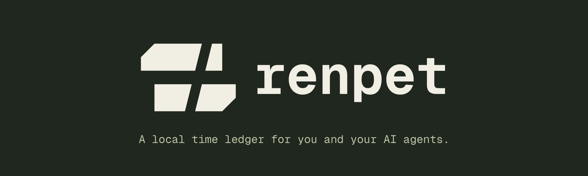
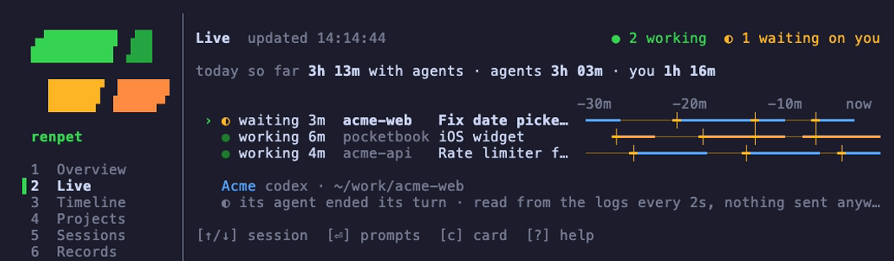
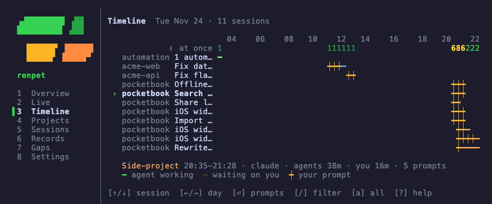
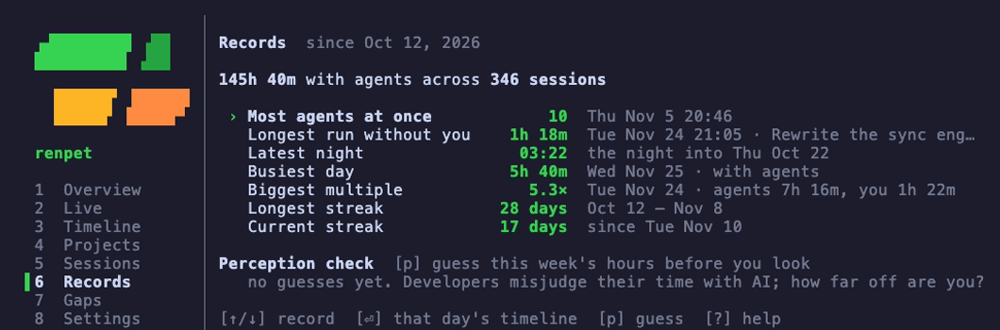
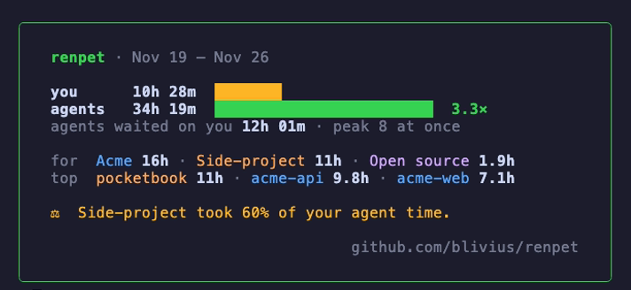

<p align="center">
  
</p>

<h3 align="center">How much of your week was you, and how much was your AI coding agents.</h3>

<p align="center">
  <a href="https://github.com/blivius/renpet/releases"></a>
  
  <a href="go.mod"></a>
  <a href="LICENSE"></a>
</p>

<p align="center">
  <a href="#try-it">Try it</a> ·
  <a href="#how-it-counts">How it counts</a> ·
  <a href="#views-and-keys">Views and keys</a> ·
  <a href="#commands">Commands</a> ·
  <a href="#settings">Settings</a>
</p>

<p align="center">
  
  <br><sub><code>renpet --demo</code>, recorded with <a href="https://github.com/charmbracelet/vhs">VHS</a> from <a href="docs/demo.tape"><code>docs/demo.tape</code></a></sub>
</p>

Renpet is a terminal app that reads the Claude Code, Codex and Antigravity logs already on your
disk and turns them into hours: yours, your agents', and who the work was for.

It is read-only and local: no daemon, no account, no network code. It measures time, not tokens or
cost ([ccusage](https://github.com/ryoppippi/ccusage) does that well).

## Try it

```sh
brew install blivius/tap/renpet               # macOS
go install github.com/blivius/renpet@latest   # macOS, Linux (Go 1.27+)
# or a binary from https://github.com/blivius/renpet/releases

renpet --demo   # a made-up developer's six weeks: try it before your own logs
renpet          # your week
```

## The numbers

| Number | What it means |
|---|---|
| **you** | wall-clock time you spent reading, reviewing and typing prompts |
| **agents** | time your agents spent working, added up across sessions, so three agents for an hour is 3h |
| **the multiple** | agents ÷ you: how much agent time each of your hours bought |
| **agents waited on you** | how long agents sat finished, waiting for your next prompt |
| **peak at once** | the most agents working at the same moment, and when |
| **for whom** | each folder's time goes to who it was for (your employer, a side project, open source), by git remote or path |

`⏎` drills down from any view: projects, then sessions, then the prompts behind them. Live (`2`) shows which agents are
working and which are waiting on you right now. A card (`c`) puts your week on one screenshot,
with `n` to blank out the names first.

<table>
  <tr>
    <td width="50%"><b>Live</b>: who is working and who is waiting on you<br></td>
    <td width="50%"><b>Timeline</b>: one day, one lane per session<br></td>
  </tr>
  <tr>
    <td width="50%"><b>Records</b>: your bests from every log on disk<br></td>
    <td width="50%"><b>Card</b>: the week on one screenshot (<code>n</code> hides names)<br></td>
  </tr>
</table>

## How it counts

A transcript is a list of timestamped events: your prompts, the agent's output, tool results.
Renpet looks at the gap between each event and the next, and **a gap counts as whatever ends
it**:

| The gap ends in… | It was | Because |
|---|---|---|
| your prompt | **you** | you were reading the last answer and writing the next prompt |
| agent output or a tool result | **agents** | the agent, or a tool it called, was working |
| anything, but it's longer than the idle gap (15 min) | nobody | you were away |

```
10:00  you      "add rate limiting to the API"
10:07  agent    last edit, tests pass           10:00–10:07  agents  7m
10:10  you      "now add tests for bursts"      10:07–10:10  you     3m
10:16  agent    done                            10:10–10:16  agents  6m
11:02  you      "back, ship it"                 10:16–11:02  nobody  (46m > 15m)
```

Sum the agents' gaps across sessions for agent-hours, take the union of every counted gap for
wall-clock time with agents, and sweep across the agents' gaps for the peak. `renpet gaps` shows your own prompt gaps so you can pick the idle gap.

## Commands

The app (`renpet`) is where everything lives: views down the left, a command palette on `:` or
`ctrl+k`, every key on `?`, and the mouse. Each view also has a plain command:

```sh
renpet week                       # last 7 days as a table (--since, --until, --json, --all)
renpet day 2026-11-22 --static    # one day as plain text (what pipes and NO_COLOR get)
renpet now                        # agents working and waiting on you right now
renpet now --short                # one line for tmux or a shell prompt: ●2 ◐1 · 4h 12m
renpet card --hide-names          # the last 7 days as a card to screenshot
renpet why my-project             # the sessions behind a project's numbers
renpet gaps                       # your prompt-gap histogram: helps pick --idle
renpet config [init]              # where settings live; init writes a starter file
```

Add `--demo` to any of them to use the made-up developer instead of your logs.

## Views and keys

`⏎` (or `→`) goes one level deeper, down to the sessions and prompts behind a number; `esc` (or
`←`) goes one back.
Number keys jump between views; `?` shows the keys for the view you're on.

| View | Shows | Keys |
|---|---|---|
| 1 Overview | The headline, the grid, the selected day's lanes, who it was for, the voice line | `↑/↓` day · `←/→` period · `⏎` projects |
| 2 Live | Sessions working now (`●`) and waiting on you (`◐`, its agent ended its turn), each with how long and its last 30 minutes as a lane, and today so far. Reads the logs every 2 s while open | `↑/↓` session · `⏎` its prompts |
| 3 Timeline | One day, one lane per session: `━` while its agent works, `─` while it waits on you, `┿` where you sent a prompt, and a row counting the agents working at once | `↑/↓` session · `←/→` day · `⏎` its prompts · `/` filter · `a` all |
| 4 Projects | The range's projects, by hours, repo name first, coloured by whom | `tab` day/range · `/` filter · `o` order (hours, name, whom) · `a` all |
| 5 Sessions | Every session, or one project's: when, agent, hours, an activity sparkline, the session's name | `tab` · `/` · `o` order (time, hours) · `a` all |
| Prompts | One session: agent and you lanes, then every prompt you sent with how long you thought before it and how long the agents ran after it | `↑/↓`; the selected prompt shows in full below |
| 6 Records | Your bests across every transcript on disk: most agents at once, longest run without you, latest night, busiest day, biggest multiple, streaks. Then your perception checks | `⏎` the timeline of that day |
| 7 Gaps | Your prompt-gap histogram with the idle line on it | `←/→` move the line · `⏎` save it as your idle gap |
| 8 Settings | Week start, idle gap, your rules, and the range's folders no rule matches | `←/→` change · `x` delete a rule · `K/J` move it · `⏎` assign a folder |

**Everywhere:** `:` or `ctrl+k` commands · `r` day·week·month · `[ ]` previous/next · `t` today
· `p` perception check · `c` card (`n` hides names) · `?` keys · `q` quit · click a view, a row (a second click opens it) or a day; scroll to move.

**The palette** reaches what the flags do: a day, week, month or custom range (`--since`,
`--until`), the idle gap (`--idle`), showing everything (`--all`), exporting the range as JSON or
a table (`--json`, `renpet week`) next to where you started Renpet, creating the settings file
(`config init`), and the theme.

- **Session names:** the name you gave a Claude Code session, else the one Claude Code gave it,
  else your first prompt. Subagents carry their parent's name (`↳ …`).
- **Folded rows:** projects under 6 minutes are hidden, automation folders are one row
  (`Automation · 57 folders`), and a subagent's time is folded into the session that started it
  (`+15 subagents`), until you press `a`. They are still in every total, and a line says so.
- **Sessions that move:** a Claude Code or Codex session that moves to another repo (a `cd`, or
  a resume from another folder) is cut where it moved. Each part counts for its own project and
  whom, so one transcript can show under two projects. A `cd` inside the same repo cuts nothing.
  Antigravity transcripts don't record folders, so they stay whole.
- **Perception check:** `p` hides the numbers and asks how many hours you spent with your
  agents in the range on screen. Then it shows what was measured and how far off you were, and
  saves the guess to `guesses.json` next to your settings. Records lists your past guesses.
- **Live and `renpet now`:** a session is live until its log has been quiet for the idle gap.
  It waits on you once its agent ended its turn: Claude Code's `end_turn`, Codex's
  `task_complete`, an Antigravity answer that calls no tool. A permission prompt still reads as
  working; agent hooks could tell the two apart later. Finished subagents and finished
  automation runs are left out.
- **Card:** `c` shows the range as a card to screenshot: you vs agents, who it was for, the top
  three projects and the voice line. `n` blanks every name (the colours stay) and drops the
  voice line if it names one. `renpet card` prints it, `--json` as data.
- **Prompt text** is read from the transcript when you open a session. It is never cached.
- **Settings save as you change them** to your config file (written through a symlink, never
  replacing it), and the range is recounted with them right away.

## The overview, in detail

- **Headline:** your hours, your agents' hours and the multiple, and how long your agents sat
  waiting for you. Next to the title, the change against the same stretch of the period before
  (a Wednesday is compared with last Monday–Wednesday, not all of last week). It is left out
  when the agents have already deleted the older logs it would need.
- **Grid:** one cell per hour, every hour labelled (00 06 12 18 stand out). Brightness is how
  much of that hour you or your agents were active, on one green ramp. A month shows as a
  calendar instead: one cell per day, brightness against the busiest day.
- **Fire cells:** hours where 3+ agents ran at once burn in a fire ramp and flicker.
- **Lanes:** the selected day is split below the grid into agents vs you.
- **Voice line:** one true line about the range, never invented. In order of priority:
  `❓ N% has no owner yet`, `⚖ … took N%`, `🔥 N agents at once`, `🌙 past midnight on N
  days`, `🧠 N% thinking`.
- **Ranges:** `r` steps day → week → month, `←/→` (or `[ ]` from any view) moves through them,
  `t` comes back to today. Custom dates are in the palette.
- **Colours** follow your terminal: a light background gets a light palette (the palette can
  switch it). `NO_COLOR` is respected.
- **Logo:** the sidebar's mark is drawn from the logo's own shapes in half blocks, so it is the
  real mark in any terminal, no image support needed.
- **Motion:** time-based at 30 fps. A 0.45 s ease-out reveal on every load, lit cells breathe
  between 90% and 100%, and fire cells flicker at 1.4 Hz.
- **Speed:** transcripts are parsed on all CPUs, and only once. How far each file has been read
  is kept in your user cache dir (`renpet/sessions-v4.gob`: timestamps, folders, session titles
  and the first 120 characters of your first prompt; never your other prompts), so
  the next run reads just the new lines. On ~670 MB of transcripts a week, the first run takes
  about 1.5 s and later runs about 0.1 s. Finished weeks also stay in memory while the view is
  open.
- **Fallback:** pipes, CI, `NO_COLOR` and `--static` get plain text: `day --static` prints the
  15-minute strips and the full table.

## What it reads

**Sources**

| Agent | Transcripts read |
|---|---|
| Claude Code | `~/.claude/projects/*/*.jsonl` |
| Claude Code subagents | `~/.claude/projects/*/<session>/subagents/*.jsonl`. Every line is agent time; the parent agent writes their "user" lines |
| Codex | `~/.codex/sessions/**/rollout-*.jsonl`, sub-sessions included |
| Antigravity | `~/.gemini/antigravity*/brain/<id>/.system_generated/logs/transcript.jsonl`. You are `USER_EXPLICIT`. The workspace comes from the CLI's `cache/conversation_metadata.json` |

**Report columns**

| Column | Meaning |
|---|---|
| with agents | wall-clock covered by any session |
| agents | agent-run time summed across sessions, so agents running in parallel add up |
| you | wall-clock in think gaps: two sessions waiting on you at once count once |
| agents waited on you | think gaps summed per session: how long your agents sat waiting for you |
| peak ∥ | the most agents working at once, and when |

**What counts as a prompt**

User lines that arrive from the system don't count as prompts:
- tool results
- task notifications
- command output
- resume summaries
- `<environment_context>`

## Picking `--idle`

`renpet gaps` shows how long you took to send each prompt after the agent's last event. Put
`--idle` where the bars thin out: shorter gaps are you thinking, longer ones are you away. On one
developer's 30 days (1,316 prompts), the rate fell from about 16 prompts per minute of gap at
10–15 min to about 6 at 15–20 min, so 15 min (the default) sat right on the knee.

## Settings

Settings live in `~/.config/renpet/config.json`. `$XDG_CONFIG_HOME` and `$RENPET_CONFIG` are
respected. Flags override the file for one run. `renpet config` shows the path and what's in
effect; `renpet config init` writes a starter file. In the app, Settings (`8`) edits the same file.

```json
{
  "week_start": "monday",
  "idle": "15m",
  "rules": [
    {"remote": "github.com/acme/", "whom": "work"},
    {"path": "~/work", "whom": "work"},
    {"path": "~/.claude/jobs", "whom": "automation"},
    {"path": "~/code", "whom": "side"}
  ]
}
```

| Setting | Meaning | Flag |
|---|---|---|
| `week_start` | First row of the week grid, `monday` … `sunday` | `--week-start` |
| `idle` | A gap longer than this is nobody's time; see below | `--idle` |
| `rules` | Who each folder's time is for. **Ordered: the first match wins** | `--rules file.json` |

**How rules match**
1. A `remote` rule matches a substring of the repo's origin URL. It works even when a work repo
   is cloned under a personal folder.
2. A `path` rule matches the folder and everything under it.
3. Anything no rule matches shows as `unknown`. It is never guessed.

The built-in default knows only `~/.claude/jobs` → automation. Your rules are personal, so they
belong in your config, not in this repo.

## Known limits

| Limit | Effect |
|---|---|
| Waiting on a permission prompt counts as agent-run | Agent hooks could split it out later |
| Antigravity IDE conversations have no workspace on disk | They show as `(no workspace)` / unknown |
| Cursor and Gemini CLI are not read | Their time is missing |
| Only time inside agent sessions is seen | Editor, browser and meetings are missing |
| Transcript formats are undocumented and can change | Unparseable lines are skipped, never guessed |
| Claude Code deletes transcripts after 30 days unless `cleanupPeriodDays` is raised | Older history is lost |

## Name and credits

Renpet was the Egyptian goddess of the year, and her name was their word for "year". The view's
grammar is borrowed from [termheat](https://gitlab.com/moeen-mahmud/termheat). Built with
[Bubble Tea](https://github.com/charmbracelet/bubbletea) and
[Lip Gloss](https://github.com/charmbracelet/lipgloss).

## License

Apache-2.0
